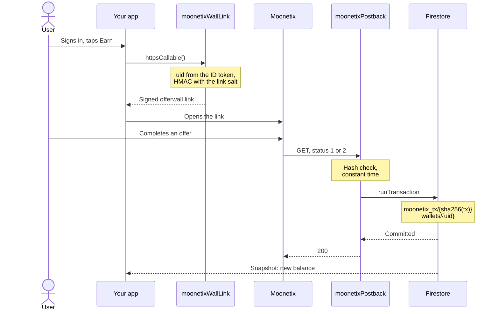

# Moonetix offerwall on Firebase Cloud Functions

**Credit offerwall rewards in Firestore exactly once, and sign the offerwall link for the Firebase Auth user, with two 2nd gen Cloud Functions.**

[](https://github.com/moonetix/offerwall-firebase-functions/actions/workflows/ci.yml)
[](LICENSE)
[](https://docs.moonetix.com/postbacks)
[](https://moonetix.com/academy/integrations/offerwall-postback-firebase)
[](https://moonetix.com/register?from=github-offerwall-firebase-functions)
[](https://moonetix.com)

[Moonetix](https://moonetix.com) is an affiliate network. You add its offerwall to your app, your users earn your own currency for completed offers, and Moonetix sends a signed postback for every credit and every reversal. This repo is the Firebase side of that: `moonetixPostback` receives the postback and updates Firestore in a transaction, and `moonetixWallLink` returns the signed offerwall link for the signed-in user.

> **Get your App ID and keys: sign up free at https://moonetix.com/register?from=github-offerwall-firebase-functions**

## What you get

1. **One credit per transaction, proven in the emulator.** The transaction document is created with `create()` inside `runTransaction`. Twenty parallel copies of one postback credit the wallet once in the Firestore emulator. A copy that loses a race is answered 200 as a duplicate, or 500 if Firestore gives up under contention, and the retry pays nothing.
2. **No secret in your app.** The link hash salt and postback key live in Cloud Secret Manager. The callable reads the user from `request.auth.uid`, never from `request.data`, and security rules keep wallets read-only for clients.
3. **Exact balances.** Rewards are stored as integers in millionths of a coin (`balanceMicro`), so `0.375` and `1.23456` add up without floating point drift. A reversal takes back the stored amount from the stored user.

## How it fits together



## Quick start

You need Node.js 22, the Firebase CLI, and a project on the Blaze plan (Cloud Functions require it).

```bash
git clone https://github.com/moonetix/offerwall-firebase-functions.git
cd offerwall-firebase-functions
firebase use --add                       # pick your Firebase project
cd functions && npm ci && cd ..

cp functions/.env.example functions/.env # set MOONETIX_APP_ID
firebase functions:secrets:set MOONETIX_LINK_SALT
firebase functions:secrets:set MOONETIX_POSTBACK_KEY
firebase deploy --only functions,firestore:rules
```

Then, in the Moonetix dashboard:

1. Offerwalls, your offerwall, Integration: copy the App ID into `functions/.env` and the link hash salt into the `MOONETIX_LINK_SALT` secret.
2. Postback page: copy the postback secret key into the `MOONETIX_POSTBACK_KEY` secret, and save this postback URL with the address the CLI printed:

```text
https://us-central1-YOUR_PROJECT.cloudfunctions.net/moonetixPostback?tx={transaction_id}&user={user_id}&reward={reward}&status={status}&offer={offer_name}&hash={hash}
```

Paste the exact URL. Moonetix does not follow redirects.

On the web, get the link and show it:

```js
import { getFunctions, httpsCallable } from 'firebase/functions';

const { data } = await httpsCallable(getFunctions(), 'moonetixWallLink')();
document.querySelector('#offerwall').src = data.url; // or open it in a WebView or the browser
```

Show the balance with a snapshot listener on `wallets/{uid}` and divide `balanceMicro` by 1,000,000.

| Setting | Where | What it is |
| --- | --- | --- |
| `MOONETIX_APP_ID` | `functions/.env` | App ID from the Integration section. Not secret. |
| `MOONETIX_LINK_SALT` | Secret Manager | Link hash salt. Signs offerwall links. |
| `MOONETIX_POSTBACK_KEY` | Secret Manager | Postback secret key. Signs postbacks. |
| `MOONETIX_CREDIT_TEST_POSTBACKS` | `functions/.env` | `true` credits dashboard test postbacks. Default `false`. |

## How it works

1. The app signs the user in with Firebase Auth and calls `moonetixWallLink`. Without a valid ID token the callable answers `unauthenticated`.
2. The callable checks that the UID fits the offerwall's user ID rules (1 to 100 characters from `A-Z a-z 0-9 . _ @ : + -`) and returns `https://wall.moonetix.com/{APP_ID}?user_id={uid}&hash={HMAC-SHA256(uid, salt)}&sub1=firebase`.
3. Moonetix calls `moonetixPostback` with a GET for every credit and every reversal. The function accepts each signed parameter exactly once and checks the HMAC-SHA256 of `tx:user:reward:status` in constant time. A bad or missing hash gets 403, any method other than GET gets 405.
4. Signed but unusable values (a status other than 1 or 2, a malformed reward) get 400 and a log line. Dashboard tests (`test_` transaction IDs) are logged and answered 200 without a credit, unless you opt in.
5. One Firestore transaction reads `moonetix_tx/{sha256(transaction_id)}` and then writes:

| Status | Stored transaction | Result |
| --- | --- | --- |
| 1 | none | create it, add the reward to `wallets/{uid}` |
| 1 | any | nothing (a retry, or a credit after its reversal) |
| 2 | credited | mark it reversed, subtract the stored amount from the stored UID |
| 2 | none | store it as reversed with amount 0, so a late credit cannot pay |
| 2 | reversed | nothing |

6. The function answers 200 only after the commit. Firestore errors give 500, and Moonetix retries up to 5 times. A parallel copy that loses the `create()` race fails with `ALREADY_EXISTS` and is answered 200.

| Path | Purpose |
| --- | --- |
| `functions/src/index.ts` | The two functions, secrets and parameters |
| `functions/src/moonetix.ts` | Link signing, hash check, amounts, decision table. No Firebase imports. |
| `functions/src/ledger.ts` | The Firestore transaction |
| `firestore.rules` | Users read their own wallet and history, clients write nothing |

## Security notes

- The salt and the postback key are Secret Manager secrets bound only to the function that needs each one. Never put them in Remote Config, the app bundle or Git.
- The user ID is the verified Firebase Auth UID. A user ID sent by the client is ignored.
- The hash is checked before anything else, with `crypto.timingSafeEqual` behind a length check, so a short forged hash is a 403, not a crash.
- Only `{reward}` is signed. `{payout}`, `{offer_name}` and the sub IDs are for logs, never for money.
- `invoker: 'public'` is needed because Moonetix calls without a Google identity token. The HMAC is the access control. Do not add App Check to the postback function; it is fine on the callable.
- A reversal can take a wallet below zero if the coins were spent. Say in your terms that rewards can be taken back, and hold withdrawals while a balance is negative.
- Reward only completed offers, never joins, invites, likes or reviews. Users must be 16 or older.

## Test it

Unit tests need no Firebase project and no packages beyond Node.js 22:

```bash
cd functions
npm test
```

They cover link signing, the hash check against tampered, short, uppercase and wrongly signed postbacks, repeated parameters, exact amounts, the decision table, and the ledger against an in-memory Firestore stand-in that applies the documented transaction rules (reads before writes, `ALREADY_EXISTS` on `create()`, retry on contention).

End to end in the Firebase Emulator Suite (needs Java 21 and the Firebase CLI):

```bash
cd functions
npm run emulator:test-config   # writes .secret.local with fake test keys
npm run test:emulator
```

This deploys both functions to the emulator and checks credits, retries, 20 parallel copies, reversals, a reversal before its credit, decimals, a `/` in the transaction ID, forged, short and repeated requests, POST, `test_` postbacks, the callable with and without sign-in, and the security rules. The `demo-moonetix` project ID needs no real Firebase project.

With Moonetix, after you deploy:

1. Offerwalls, your offerwall, Integration: under Integration status, use **Check a link** and compare **Test a link** for a UID with what `moonetixWallLink` returns for that user.
2. Click **Send a test postback**, or use the Postback page. The function logs `test postback (not credited)` and answers 200. Set `MOONETIX_CREDIT_TEST_POSTBACKS=true` if you want the test to credit a test account.
3. Every attempt and the status your function returned is listed under Reports, Postbacks.
4. Open the offerwall from a normal home or mobile connection. VPNs, proxies and data center networks see a block page.

## When something fails

The postback function answers with an empty body, so read the status code in Reports, Postbacks together with the function log (`firebase functions:log --only moonetixPostback`).

| Symptom | Cause | Fix |
| --- | --- | --- |
| 403 | The hash is missing or wrong, or a signed parameter was sent twice. | Use the postback secret key, not the link hash salt. Paste the logged URL into the [hash checker](https://moonetix.com/tools/postback-hash-checker). |
| 400, log `postback with unexpected values` | Signed, but the reward is not a plain number, the status is not 1 or 2, or the user is not a valid UID. | Check the macros in the saved postback URL against the one above. |
| 500, log `postback key missing` | The `MOONETIX_POSTBACK_KEY` secret is not set or not granted to the function. | Run `firebase functions:secrets:set MOONETIX_POSTBACK_KEY` and deploy again. |
| 500, log `postback failed` | The Firestore transaction did not commit. Nothing was stored. | Moonetix retries. The `err` field of the log line has the Firestore error. |
| 200 but no coins | A `test_` transaction, which is logged as `test postback (not credited)`. | Expected. Set `MOONETIX_CREDIT_TEST_POSTBACKS=true` only on a test project. |
| Callable throws `unauthenticated` | The app called `moonetixWallLink` before Firebase Auth signed the user in. | Wait for `onAuthStateChanged` before calling. |
| `Could not start Firestore Emulator, port taken` | Something else listens on 8080 (or 9099 for Auth). | Change the port in `firebase.json`. The emulator test reads `FIRESTORE_EMULATOR_HOST` and `FIREBASE_AUTH_EMULATOR_HOST`, so it follows. |

## Learn more

- Academy: [Offerwall postback with Firebase Cloud Functions](https://moonetix.com/academy/integrations/offerwall-postback-firebase), the step by step version of this repo
- Academy: [Prevent duplicate reward credits](https://moonetix.com/academy/integrations/prevent-duplicate-reward-credits)
- Docs: [Postbacks](https://docs.moonetix.com/postbacks), [Offerwall link](https://docs.moonetix.com/offerwall-link), [Credits and reversals](https://docs.moonetix.com/credits-and-reversals), [Testing](https://docs.moonetix.com/testing)
- Moonetix for [apps](https://moonetix.com/industries/apps) and the [Android](https://moonetix.com/integrations/android), [iOS](https://moonetix.com/integrations/ios) and [Flutter](https://moonetix.com/integrations/flutter) SDKs
- Tools: [postback hash checker](https://moonetix.com/tools/postback-hash-checker), [offerwall link builder](https://moonetix.com/tools/offerwall-link-builder)

## Start earning

**Get your App ID and keys: sign up free at https://moonetix.com/register?from=github-offerwall-firebase-functions**

Every publisher application is reviewed by hand. Once you are approved, add your app, set your currency name and rate, and deploy.


## More Moonetix examples

| Repository | What it covers |
| --- | --- |
| [awesome-offerwalls](https://github.com/moonetix/awesome-offerwalls) | Curated list of offerwall networks, tools and guides |
| [offerwall-postback-handlers](https://github.com/moonetix/offerwall-postback-handlers) | Postback handlers in PHP, Node.js, Python and Java |
| [offerwall-nextjs-starter](https://github.com/moonetix/offerwall-nextjs-starter) | Next.js App Router starter |
| [telegram-mini-app-offerwall](https://github.com/moonetix/telegram-mini-app-offerwall) | Telegram Mini App with server-side `initData` checks |
| [discord-rewards-bot](https://github.com/moonetix/discord-rewards-bot) | Discord bot with an economy and offerwall rewards |
| [moonetix-offerwall-wordpress](https://github.com/moonetix/moonetix-offerwall-wordpress) | WordPress plugin |
| [moonetix-android-sdk](https://github.com/moonetix/moonetix-android-sdk) | Android SDK |
| [moonetix-ios-sdk](https://github.com/moonetix/moonetix-ios-sdk) | iOS SDK |
| [moonetix-flutter](https://github.com/moonetix/moonetix-flutter) | Flutter plugin |
| [moonetix-react-native](https://github.com/moonetix/moonetix-react-native) | React Native package |
| [moonetix-unity](https://github.com/moonetix/moonetix-unity) | Unity package |
| [offerwall-laravel](https://github.com/moonetix/offerwall-laravel) | Laravel integration |
| [offerwall-django](https://github.com/moonetix/offerwall-django) | Django integration |
| [offerwall-express](https://github.com/moonetix/offerwall-express) | Express integration |
| [offerwall-vue-nuxt](https://github.com/moonetix/offerwall-vue-nuxt) | Vue and Nuxt integration |
| [offerwall-supabase](https://github.com/moonetix/offerwall-supabase) | Supabase Edge Functions with Postgres |
| [offerwall-react-vite](https://github.com/moonetix/offerwall-react-vite) | React and Vite app with a small Node.js backend |
| [rewards-site-starter](https://github.com/moonetix/rewards-site-starter) | Rewards (GPT) site starter in PHP and SQLite |
| [offerwall-unity-example](https://github.com/moonetix/offerwall-unity-example) | Unity sample game |
| [offerwall-godot](https://github.com/moonetix/offerwall-godot) | Godot integration |
| [offerwall-html5-game](https://github.com/moonetix/offerwall-html5-game) | HTML5 game integration |
| [offerwall-flutter-example](https://github.com/moonetix/offerwall-flutter-example) | Flutter sample app |
| [offerwall-react-native-example](https://github.com/moonetix/offerwall-react-native-example) | React Native sample app |
| [offerwall-chrome-extension](https://github.com/moonetix/offerwall-chrome-extension) | Chrome extension |
| [offerwall-electron](https://github.com/moonetix/offerwall-electron) | Electron desktop app |
| [postback-tester](https://github.com/moonetix/postback-tester) | Sends signed test postbacks and catches double credits, missed reversals and forged requests |
| [signup-guard](https://github.com/moonetix/signup-guard) | Sign-up risk checks for Node.js and PHP: disposable emails, datacenter and Tor IPs |
| [datacenter-ip-ranges](https://github.com/moonetix/datacenter-ip-ranges) | Daily cloud, Tor and iCloud Private Relay IP ranges from official feeds |
| [offerwall-fraud-playbook](https://github.com/moonetix/offerwall-fraud-playbook) | Fraud playbook for offerwall and rewards publishers, with tested code |
| [reward-economy-kit](https://github.com/moonetix/reward-economy-kit) | Integer points math: payout to points, bonuses, reversals, cash-out pricing |
| [referral-engine](https://github.com/moonetix/referral-engine) | Referral codes, attribution and a clawback-safe commission ledger |
| [gamification-kit](https://github.com/moonetix/gamification-kit) | Streaks, XP levels, quests and leaderboards that survive time zones and DST |
| [affiliate-postback-macros](https://github.com/moonetix/affiliate-postback-macros) | Postback macros and signatures of tracking platforms and offerwalls |
| [country-tiers](https://github.com/moonetix/country-tiers) | Tier 1, 2 and 3 countries as JSON and CSV, with helpers in JavaScript, PHP and Python |

## License

MIT. See [LICENSE](LICENSE).
